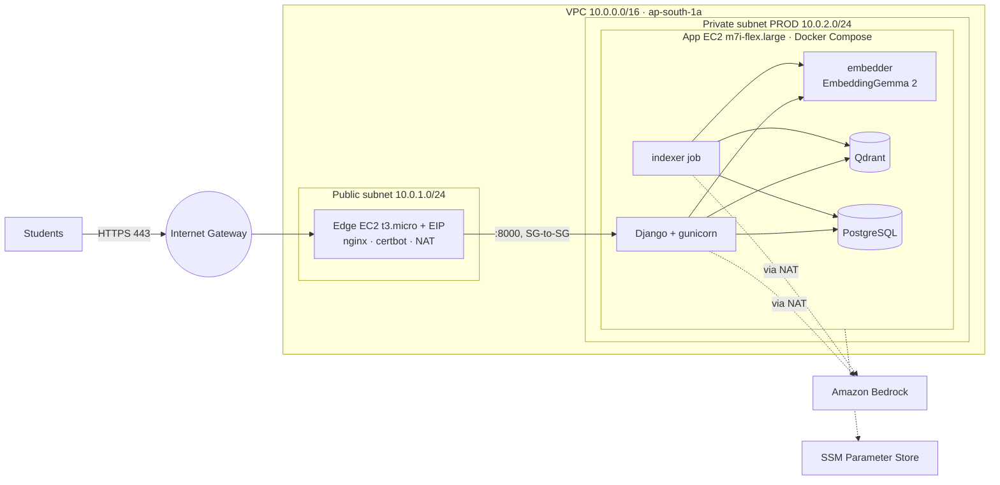
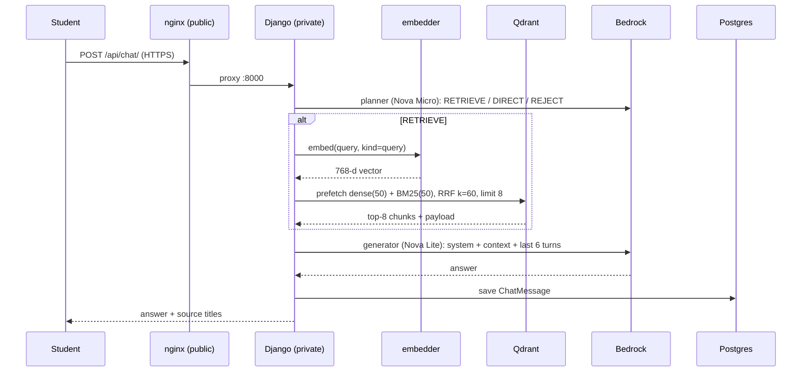
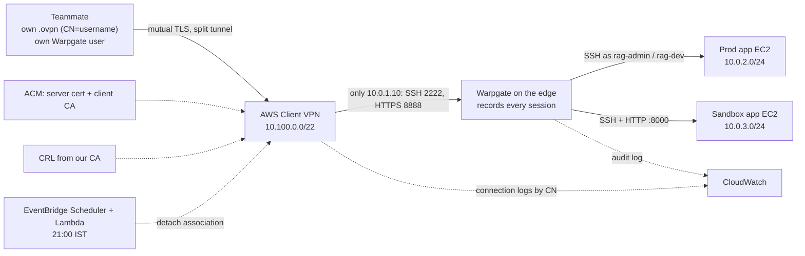
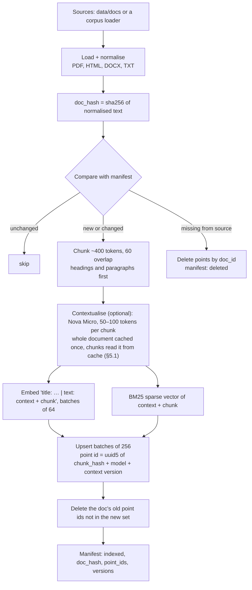

# LPU RAG v2: hybrid RAG on AWS with a VPN-only sandbox

> Design spec, 3 Nov 2026. Status: **draft for review**. Nothing is deployed yet.
> Diagrams ([`docs/architecture/aws-architecture.drawio`](../../architecture/aws-architecture.drawio), two pages):
> - page 1, request path: [PNG](../../architecture/aws-architecture.png)
> - page 2, team access and sandbox: [PNG](../../architecture/team-access.png)
>
> Facts behind the decisions were checked against vendor docs and the AWS Price List API on 3 Nov 2026 (§15).

## 1. Goal

Rebuild the LPU UMS assistant so retrieval is production-grade and backed by measured numbers, then run it like a small production service:

- **Hybrid retrieval:** BM25 keyword search and vector search, fused with Reciprocal Rank Fusion (RRF).
- **Contextual retrieval:** each chunk gets a short LLM-written context from its parent document before indexing.
- **Self-hosted embeddings:** EmbeddingGemma 2 on CPU. No per-token embedding bill; queries stay inside the VPC.
- **An incremental indexing pipeline:** content-hash dedup, retries, resumable runs, deletes for removed documents.
- **A scale test at ~1M documents:** retrieval quality, latency, throughput, memory and cost per million documents.
- **Network:**
  - **public subnet:** nginx edge;
  - **production** stack in a private subnet;
  - a **sandbox** that copies production, in its own private subnet.
- **Team access:**
  - AWS Client VPN, with **one certificate per person**;
  - a **Warpgate** bastion where each person signs in with their own username;
  - **SSH and sandbox access only through VPN → Warpgate**, with every session and request **recorded**;
  - per-user logins and API tokens in the sandbox.
- **Observability:** CloudWatch for logs, metrics, alarms and a dashboard, plus VPC Flow Logs for every network flow.

**Success criteria**
1. The app answers university questions end to end on the new stack, in prod and in the sandbox.
2. The scale test indexes **≥ 1,000,000 passages** and publishes a results table (§10.5) with every number measured.
3. Re-running the indexer on unchanged input writes **0 points** (tested).
4. From the internet only the edge's 80/443 answer. From the VPN only `10.0.1.10:2222/8888` (Warpgate) answer. App port 22 and the sandbox's 8000 accept only the edge SG. All of this is tested from outside, from inside the VPN, and from the sandbox.
5. Every human action is attributable to one person and replayable: VPN logs by certificate CN; SSH sessions and sandbox HTTP requests recorded by Warpgate under the person's username; sandbox app actions by Django user. The one exception is admin break-glass through Session Manager: it's restricted to the admin IAM user, logged to `/rag/ssm-sessions` and attributed in CloudTrail.
6. CloudWatch holds the app, nginx, Warpgate, VPN and VPC Flow logs; the alarms in §8.2 email on failure.
7. First-month AWS spend stays **under $65** of the $99.63 Free-plan credits (itemised in §11; budget alerts at $35/$50/$60).

**Non-goals:** multi-AZ high availability, autoscaling, reranking models, user-facing document upload, Kubernetes, SSO for the VPN.

## 2. Decisions

| # | Decision | Choice | Why |
|---|---|---|---|
| D1 | Embedding model | **`google/embeddinggemma-2`, text-only mode (270M params)**, 768-d, own container, CPU | Released 6 Oct 2026, Apache 2.0, 8,192-token context, Matryoshka 768/512/256/128. No API cost; queries stay in the VPC. |
| D2 | Embedding precision | float32; bfloat16 only if a parity test passes (cosine ≥ 0.999 vs float32 on 1,000 passages) | The model card warns **never float16** (silent NaNs). |
| D3 | Search engine | **Qdrant**, one collection with a dense and a BM25 sparse vector | 1M × 768-d int8 ≈ 1 GB RAM. OpenSearch's 4 GiB heap guidance alone is half the 8 GiB box. Hybrid and fusion run in one query. |
| D4 | BM25 | Client-side sparse vectors (FastEmbed `Qdrant/bm25`), collection `modifier: idf` | Server-side BM25 inference is only documented for Qdrant Cloud. |
| D5 | Fusion | RRF with **k = 60 set explicitly** | Qdrant's default k is 2. |
| D6 | LLMs | **Amazon Bedrock**: Nova Micro for chunk context and the planner, Nova Lite for answers. APAC inference profiles `apac.amazon.nova-micro-v1:0`, `apac.amazon.nova-lite-v1:0`. The phase-2 test call first tries the in-Region `amazon.nova-micro-v1:0` for the contextualiser, because a single region keeps prompt-cache hits higher. | Paid from AWS credits, authorised by instance roles (no keys), cheapest listed in Mumbai. |
| D7 | Network | One VPC, `10.0.0.0/16`, one AZ. **Public** `10.0.1.0/24` (edge), **private prod** `10.0.2.0/24`, **private sandbox** `10.0.3.0/24` | Clear trust boundaries. The sandbox shares the VPC by user choice; separate SGs, instances, data and secrets keep it apart. |
| D8 | Reverse proxy | **nginx** + certbot (Let's Encrypt, HTTP-01) on the edge instance | User's choice; also rate limits and static files. |
| D9 | Egress | **NAT instance on the edge** by default; a **managed NAT Gateway switched on only for image and model pulls** (Terraform toggle) | A NAT Gateway costs $0.056/h + $0.056/GB plus its IPv4 ($0.005/h) in Mumbai, ~$44.5/month if always on. Pulls need it for a few hours a month. |
| D10 | Team VPN | **AWS Client VPN, mutual TLS**: one client certificate per person (CN = username) from our own CA; server cert and client CA imported into ACM; revocation via CRL | User's choice; same model as the team's existing work VPN. |
| D11 | VPN cost control | Terraform keeps the endpoint. The **subnet association is not a Terraform resource**: `make vpn-up`/`vpn-down` attach and detach it with the CLI, and a Lambda **detaches it hourly from 21:00 to 08:00 IST** | Billing is $0.15/h per association + $0.05/h per connection. Always attached = ~$110/month, more than the credits. |
| D12 | SSH and internal HTTP | **Warpgate** (Apache-2.0, single Rust binary) on the edge at `10.0.1.10`. VPN clients can reach **only Warpgate** (SSH 2222, HTTPS 8888). App instances accept 22/8000 **only from the edge SG**. Each person has their own Warpgate user; Warpgate reaches targets with its own key as role accounts `rag-admin` / `rag-dev`. | User requirement: per-user names, and every SSH session and sandbox request recorded and replayable. Same pattern as the team's work bastion. Session Manager stays as **admin break-glass**: limited to the admin IAM user, sessions logged to `/rag/ssm-sessions`. It needs egress through the edge NAT or `make pull-on`. |
| D13 | Identity source | One file, `team/users.yaml`, drives VPN certificates, Warpgate users/roles and sandbox app users | Add or remove a person in one place. |
| D14 | Compute | Prod: `m7i-flex.large` (8 GiB). Sandbox: `c7i-flex.large` (4 GiB). Edge: `t3.micro`. Stopped when idle | All Free-plan eligible on this account (checked). |
| D15 | IaC | **Terraform** in `infra/`, one `app_env` module used twice (prod, sandbox) | The sandbox is the same code with different variables, so it really replicates prod. |
| D16 | App | Keep **Django + LlamaIndex** and the planner/retriever/generator agents; add per-user API tokens | Reuse what works. |
| D17 | Scale-test corpus | **BEIR Natural Questions**, 1M-passage subset keeping every judged-relevant passage | CC BY-SA, 3,452 judged queries. MS MARCO is non-commercial research only. |
| D18 | Observability | **CloudWatch**: agent on all three hosts (memory, disk, journald), Docker `awslogs` driver, VPC Flow Logs, Client VPN logs, 9 alarms → SNS email, one dashboard | Everything recorded in one place, inside the always-free allowances (5 GB logs, 10 alarms, 10 custom metrics, 3 dashboards) at this size. |

## 3. Architecture: request path (diagram page 1)



### 3.1 Components (same Compose file in prod and sandbox)

| Component | Image / runtime | Role |
|---|---|---|
| Warpgate (edge only) | official Warpgate Docker image in the edge Compose file (`deploy/edge/docker-compose.yml`), exact version pinned at build (§14); data in `/var/lib/warpgate` (root-only bind mount) | SSH 2222 and HTTPS 8888 on `10.0.1.10`; per-user auth, roles, session recording |
| CloudWatch agent (all hosts) | `amazon-cloudwatch-agent` package | journald + host metrics to CloudWatch |
| nginx (edge only) | `nginx:1.27-alpine` | TLS on 443, 80 → 443, `limit_req` on `/api/`, proxy to prod `10.0.2.x:8000`, ACME challenge path |
| certbot (edge only) | `certbot/certbot` container run by a systemd timer twice a day; shares the ACME webroot and `letsencrypt` volume with nginx | Issues and renews the certificate; a deploy-hook reloads nginx |
| NAT (edge host) | `iptables MASQUERADE`, `ip_forward=1`, source/dest check off | Default egress for both private subnets |
| web | this repo's Dockerfile (Python 3.11), gunicorn 2 workers | UI, auth, `/api/chat/`, orchestrator |
| embedder | new `embedder/` image: FastAPI + sentence-transformers, CPU torch | `POST /embed {texts, kind: query or document, titles?}` → normalized 768-d vectors |
| qdrant | `qdrant/qdrant`, exact version pinned at build (§14) | Hybrid index, Compose network only, API key |
| db | `postgres:16-alpine` | Django tables, chat log, manifest, API tokens |
| indexer | same image as web, `manage.py index_docs` | One-shot job (Compose profile `jobs`) |

**Images:**
- GitHub Actions builds the `web` and `embedder` images on every tag push and pushes them to GHCR (public).
- Hosts pull them while the NAT Gateway is on.
- Model weights download once into a named volume (`hf-cache`) in the same window. After that the app needs no internet for embeddings.

**Embedder load (pinned).**
- Loaded with `SentenceTransformer("google/embeddinggemma-2", revision=<commit sha>, model_kwargs={"torch_dtype": torch.float32}, config_kwargs=<text-only settings from the model card>)`.
- Documents are formatted by hand as `title: {title} | text: {content}` (`title: none` when there's no title), because `prompt_name="Document"` always sends `title: none`. Queries use `prompt_name="SearchQuery"`.
- Contract tests check that the loaded model has about 270M parameters, and that a titled document embeds differently from `title: none`.

### 3.2 Request flow



- **REJECT** returns the fixed out-of-scope message without retrieval (as today).
- **Fallback (kept from v1):** if the generator fails, return the top passages with a warning. If retrieval fails too, return a friendly error.
- Query embeddings use the model's format `task: search result | query: {q}`; documents use `title: {title} | text: {content}`.

## 4. Team access and the sandbox (diagram page 2)



### 4.1 One identity per person

`team/users.yaml` is the only list of people. It is committed **without secrets**; public keys are fine.

```yaml
users:
  - username: jashan          # VPN cert CN, Warpgate username, sandbox login
    name: Jashanprit Singh
    ssh_key: "ssh-ed25519 AAAA... jashan@laptop"
    prod: admin               # admin | dev | none
    sandbox: admin            # admin | dev | none
```

**Warpgate targets and roles.** Warpgate signs in to the target with its own key pair, so the person never holds a key for the server.

| Target | Kind | Connects as | Role allowed |
|---|---|---|---|
| `prod-admin` | SSH `10.0.2.x:22` | `rag-admin` (sudo, docker) | prod `admin` |
| `prod-dev` | SSH `10.0.2.x:22` | `rag-dev` (shell + `sudo /usr/local/bin/rag-logs`, read-only `docker compose logs`) | prod `admin`, `dev` |
| `sandbox` | SSH `10.0.3.x:22` | `rag-dev` **with docker** (variable `rag_dev_docker = true` only in the sandbox). Root-equivalent there, which is acceptable because it holds no prod data and its IAM role can't write prod or edge logs (§8.1) | sandbox `admin`, `dev` |
| `sandbox-web` | HTTP `http://10.0.3.x:8000` | the browser session, proxied | sandbox `admin`, `dev` |

**Usage:** `ssh -p 2222 jashan:prod-dev@10.0.1.10` for SSH; `https://10.0.1.10:8888` for the sandbox app and session replays.

| Access | Mechanism | How it's managed |
|---|---|---|
| VPN | Client cert with `CN=<username>`, signed by our CA (easy-rsa). The CA private key lives **offline** on the admin's laptop, encrypted, never on AWS. | `team.py vpn-issue <user>` writes `<user>-rag.ovpn` (endpoint config + that user's cert/key), handed over privately. `team.py vpn-revoke <user>` adds the cert to the CRL and imports it into the endpoint. |
| Warpgate | One user per person, with their SSH public key, plus a password with **TOTP required** for the web UI. The credential policy is set per user (`http: [Password, Totp]`, `ssh: [PublicKey]`), so a password-only web login and a password SSH login are both refused. Roles as in the table above. | `team.py sync` calls the Warpgate admin API (OpenAPI) over the VPN; the admin web UI is the fallback. |
| Servers | Only two **role accounts**, `rag-admin` and `rag-dev`. Each accepts **only Warpgate's public key** and is created at boot by user-data. No personal Linux accounts, no passwords, no root login. | Terraform user-data |
| Sandbox app + API | A Django user per person. A random first password is delivered once; the user changes it on Django's password-change page. Per-user API tokens are stored as SHA-256 hashes and shown once. `/api/chat/` accepts `Authorization: Bearer <token>`. Scripts first authenticate to Warpgate (a Warpgate ticket for the `sandbox-web` target), then send the Django token. | `manage.py team_sync`, run in the sandbox by `team.py sync` through Warpgate |
| Removal | `team.py remove <user>`: revoke the VPN cert, disable the Warpgate user, deactivate the Django user, revoke tokens. Recordings are kept. | one command |

**What Warpgate records.**
- Every SSH session: full terminal output, replayable in the admin UI.
- Every HTTP request through `sandbox-web`.
- Each recording is tied to the Warpgate username, target, time, and source IP. The source IP is a Client VPN ENI address; the identity comes from the Warpgate username.

The session index lives in Warpgate's SQLite database under `/var/lib/warpgate` on the edge's EBS volume. A nightly EBS snapshot (Data Lifecycle Manager) keeps 7 days; recordings older than 90 days are pruned.

**Hardening (app instances).**
- sshd: `PasswordAuthentication no`, `PermitRootLogin no`, `AllowUsers rag-admin rag-dev`, `MaxAuthTries 3`. The SG admits 22 only from the edge SG.
- Instance metadata is blocked for non-root local users (`iptables -A OUTPUT -d 169.254.169.254 -m owner ! --uid-owner 0 -j DROP`), so `rag-dev` can't read the instance role's credentials. Docker containers still use IMDSv2 through the daemon.

**Limits of certificate-only Client VPN.**
- Authorization rules can't tell users apart without SAML or AD.
- The rule therefore allows **only `10.0.1.10/32`** (Warpgate) for everyone.
- Warpgate roles decide what each person can reach. A user without a role sees no targets.

### 4.2 Client VPN settings

| Setting | Value |
|---|---|
| Authentication | Mutual (certificate). Server cert and client root CA imported into ACM (importing is free). |
| Client CIDR | `10.100.0.0/22` (AWS minimum /22, no overlap with the VPC) |
| Split tunnel | **On**: only VPC routes use the VPN; everything else stays on the user's own internet |
| Transport / port | UDP 443 |
| DNS | **Not set**: clients keep their own resolver. The authorization rule only allows Warpgate, so the VPC resolver would be unreachable. If VPC DNS is ever needed, add a rule for `10.0.0.2/32`. |
| Session timeout | 8 h; client reconnects with the same cert. **Importing a CRL resets every current session**, so `team.py vpn-revoke` warns that everyone will reconnect. |
| Authorization rule | Allow only `10.0.1.10/32` (Warpgate) to authenticated clients |
| Target network | One association, in the public subnet. Its ENIs use security group `vpn`. |
| Connection logging | CloudWatch log group `/rag/client-vpn` (connect/disconnect, CN, source IP), retention 90 days |
| Cost guard | **The association is not a Terraform resource.** Terraform owns the endpoint, its SG/VPC binding and the authorization rule, all of which survive disassociation. `make vpn-up` / `make vpn-down` call `associate-` / `disassociate-client-vpn-target-network` (associating takes ~5–10 min). EventBridge Scheduler runs the `vpn_off` Lambda **hourly from 21:00 to 08:00 IST**: it detaches any association, and emails through SNS if a NAT Gateway has existed for more than 6 h. |

### 4.3 How the sandbox replicates prod

- **Same Terraform module** (`infra/modules/app_env`) with `env = "sandbox"`. Same AMI family, same user-data, same Compose file and image tags.
- **Differences, all explicit variables:**
  - instance type (`c7i-flex.large`);
  - subnet (`10.0.3.0/24`);
  - SSM path (`/rag/sandbox/*` vs `/rag/prod/*`);
  - Qdrant collection data;
  - `ALLOWED_HOSTS` and `CSRF_TRUSTED_ORIGINS`: the sandbox includes `https://10.0.1.10:8888` and the Host header Warpgate forwards;
  - `rag_dev_docker` (true only in the sandbox);
  - no public route: nginx on the edge does **not** proxy to the sandbox.
- **Sandbox URL:** the `sandbox-web` target in Warpgate (`https://10.0.1.10:8888`). Requests are recorded per user; there's no direct route to `10.0.3.x:8000` from the VPN.
- **Data:** the sandbox indexes the same public university documents. It never receives prod chat logs or users.
- **Promotion:** a change runs in the sandbox first. Prod updates by moving the same tag: `make deploy ENV=prod TAG=v2.x` sends an SSM Run Command (`AWS-RunShellScript`) to the instance tagged `Env=prod`. It checks out the tag and pulls its GHCR images (turn the NAT Gateway on first if the images are new), then runs `docker compose up -d`. The same path works before the VPN exists.

## 5. Indexing pipeline



**Idempotency.**
- `chunk_hash = sha256(doc_id + chunk_text)`.
- `point_id = uuid5(NS, f"{embed_fp}:{sparse_fp}:{context_version}:{chunk_hash}")`, where:
  - `embed_fp` = `model@revision:dtype:dim`;
  - `sparse_fp` = FastEmbed version + BM25 `k`, `b`, `avg_len`.
- For **contextualised** collections the ID also includes `doc_hash`. Editing a document changes every chunk's context, so unchanged chunk text still gets re-contextualised.
- The indexer asks Qdrant which IDs already exist and skips them, so an unchanged re-run embeds and writes nothing. When a skipped point's position moved, only its `chunk_idx` payload is updated.

**BEIR loader (scale test).**
- One passage = one point. The chunker is bypassed.
- `doc_id` = the BEIR passage `_id`, so the eval runner maps hits to qrels directly.
- An `article` payload field (the passage title) is used for grouping during contextualisation and for article-level deletes.
- A test checks that every qrel `_id` in the subset appears exactly once in the collection.

**Delete safety and concurrency.**
- An empty or failed source listing is fatal.
- A run refuses to delete more than 10% of indexed documents unless given `--allow-mass-delete`.
- Each run holds a per-collection Postgres advisory lock (`pg_try_advisory_lock`). A second concurrent run exits immediately.

**Manifest** (Postgres `rag_document`): `doc_id`, `source_uri`, `title`, `doc_hash`, `chunk_count`, `point_ids`, `embed_model`, `context_version`, `status` (`pending`, `indexing`, `indexed`, `failed`, `deleted`), `error`, `updated_at`.

**Failure handling.**
- Bedrock calls retry with exponential backoff and jitter (max 6) on throttling and 5xx; embedder and Qdrant calls do the same (max 4).
- A batch that still fails marks its documents `failed` with the error, and the run continues; `--retry-failed` picks them up later.
- A crash leaves documents `indexing`; the next run treats them as changed, and idempotent upserts prevent duplicates.

**Throughput.**
- Bounded queues between stages for backpressure.
- `--workers` caps Bedrock concurrency below the account's Nova Micro quota.
- `--bulk` sets the collection's `indexing_threshold` to 0 during upload so HNSW is built once at the end, then restores it and waits for green. The HNSW build time is reported separately.

### 5.1 Contextual retrieval, with each document cached once

At ingestion, every chunk gets a 50–100 token context written by Nova Micro. It uses Anthropic's published prompt: the whole document, then the chunk, then "a short succinct context to situate this chunk within the overall document for the purposes of improving search retrieval". The context is stored in the payload and indexed by **both** BM25 and the embedding.

**Cost control: the whole document is a cached prompt prefix.**
- Without caching, a document with *N* chunks would be sent, and its prefill computed, *N* times.
- With Bedrock prompt caching, the request is laid out as:
  1. a fixed preamble + the **full document text** (the cached prefix);
  2. a `cachePoint`;
  3. the chunk + the instruction, the only part that changes per call. This keeps Anthropic's prompt order: document, chunk, instruction.
- The first chunk's call writes the document to Bedrock's cache. Every later chunk of the same document **reads it from cache instead of re-running prefill on it**.
- Cached tokens are billed at the cache-read rate: **$0.01025 per 1M** for Nova Micro in Mumbai, versus $0.041 uncached, so **75% cheaper**. Responses come back faster too.
- What it does *not* do:
  - Cached reads are not free.
  - The first call per document pays full input price. The Price List has no separate Nova write rate, so writes are assumed to bill at the normal input price; this is checked against `cacheWriteInputTokens` on the first run.
  - The output tokens (the context itself) are always paid.
- None of this runs on our EC2 CPU. LLM prefill happens on Bedrock. Our CPU only runs EmbeddingGemma 2, which embeds each chunk once and has no prefill to cache.

**Worked example** (Nova Micro, Mumbai): a 5,000-token document cut into 12 chunks of ~400 tokens, with ~100 tokens of instructions and ~80 output tokens per chunk.

| | Input billed | Cost per document |
|---|---|---|
| No cache | 12 × 5,500 = 66,000 tokens at $0.041/M | ≈ $0.00271 + output $0.00016 = **$0.00287** |
| Document cached | 1 × 5,500 at $0.041/M, plus 11 × (5,000 cache-read at $0.01025/M + 500 at $0.041/M) | ≈ $0.00101 + output $0.00016 = **$0.00117** (−59%) |

The example assumes every later chunk is a cache hit, which is the best case; real runs report the measured hit ratio.

The saving grows with document length and chunk count. For the 100K-passage NQ experiment, the cached block is a **fixed window of consecutive passages from the same article** (≤ 18K tokens). An article is the set of passages sharing a `title`, joined in numeric `_id` order.

**Rules that make the cache hit:**
- **Order:** all chunks of one document are processed back to back. One call primes the cache, and the remaining chunks are sent **only after the priming call's response has started** (in parallel up to the worker limit), within the **5-minute cache TTL**, which resets on each hit. Documents are interleaved only *between* documents, never mid-document.
- **Region:** an APAC cross-region profile can route calls to different regions, which turns would-be reads into writes. The phase-2 test decides whether the in-Region model is available. Either way the hit ratio is measured, not assumed.
- **Byte-identical prefix:** the document text and instructions are frozen per `context_version`, so the prefix is the same for every chunk. Anything that changes per call (chunk text, index) goes **after** the `cachePoint`.
- **Size limits:**
  - Nova caches a prefix of **at least 1K tokens** and up to **~20K tokens**.
  - Shorter documents simply aren't cached (they're cheap anyway).
  - Longer documents are split into sections of ≤ 18K tokens on headings. Each chunk is contextualised with its enclosing section plus a one-paragraph document summary, generated once per document and cached with the section.
- **On-demand only:** Bedrock prompt caching isn't available with batch inference, so the contextualiser uses on-demand Converse calls with `--workers` concurrency.
- **Verified, not assumed:** every response's `usage` (`cacheReadInputTokens`, `cacheWriteInputTokens`, `inputTokens`, `outputTokens`) is logged per document. The run report shows the cache-hit ratio and the actual cost, and a unit test checks that the `cachePoint` sits after the document and before the chunk.
- **Pilot gate:** the 1K-passage pilot reports the measured hit ratio and $/passage. The 100K run starts only if the projected cost is **≤ $8**; the upper bound is the no-cache cost.

## 6. Index design (Qdrant)

Collections: `lpu_docs` (app), `nq_1m` (scale test), `nq_100k_ctx` (contextual experiment).

| Setting | Value | Reason |
|---|---|---|
| dense `dense` | 768, cosine | Native EmbeddingGemma 2 output |
| quantization | scalar int8, quantile 0.99, kept **in RAM** (Qdrant ≥ 1.20: memory tier `pinned`; 1.19: `always_ram: true`) | ~0.77 GB for 1M vectors |
| originals | **on disk** (≥ 1.20: tier `cold`; 1.19: `on_disk: true`) | ~3.1 GB float32 at 1M stays on EBS |
| HNSW | `m: 16`, `ef_construct: 100`, graph in RAM | ~0.15 GB at 1M |
| search | `hnsw_ef: 128`; rescoring off by default, measured both ways | gp3's 3,000 IOPS can hurt p95 when rescoring reads from disk |
| sparse `bm25` | `modifier: idf`, index in RAM. FastEmbed `Bm25` gets `avg_len` computed per collection from its tokenised corpus; `k`, `b` and `avg_len` are recorded in the results JSON and in `sparse_fp`. Queries use `query_embed`. | BM25 |
| payload | `doc_id`, `title`, `source_uri`, `chunk_idx`, `text`, `context`, `chunk_hash`; keyword index on `doc_id` | Deletes and filters |
| inline storage | **off**; every tier set explicitly as above, and asserted by the schema unit test | Qdrant 1.20 changed tier defaults; RSS checked with `docker stats` |

```json
{
  "prefetch": [
    {"query": [/* 768-d */], "using": "dense", "limit": 50,
     "params": {"hnsw_ef": 128, "quantization": {"rescore": false}}},
    {"query": {"indices": [...], "values": [...]}, "using": "bm25", "limit": 50}
  ],
  "query": {"rrf": {"k": 60}},
  "limit": 8,
  "with_payload": ["doc_id", "title", "text", "context", "source_uri"]
}
```

- Arm C-r uses `"quantization": {"rescore": true, "oversampling": 2.0}`.
- The eval runner asks for `limit: 100`; production keeps 8.

**RAM at 1M passages on the 8 GiB prod box:**

| Item | Size |
|---|---|
| Qdrant int8 + HNSW + IDs | ~1.0 GB |
| BM25 index | measured |
| embedder | ~1.1–1.5 GB |
| Postgres + Django + indexer | ~1.0 GB |
| OS + page cache | the rest |

The sandbox (4 GiB) only holds `lpu_docs`.

## 7. Application changes

| File | Change |
|---|---|
| `chatbot/services.py` | Replace `AmazonKnowledgeBasesRetriever` with `HybridRetriever` (§6), and the GitHub Models / InvokeModel LLM setup with Bedrock Converse (Nova Lite answers, Nova Micro planner). Keep the raw-passage fallback. |
| `chatbot/agents.py` | `RetrieverAgent` uses `HybridRetriever`; context lines carry titles so answers can cite sources. |
| `chatbot/views.py` | **Remove `debug_db`** (publicly exposes the DB host and which secrets are set). **Drop `@csrf_exempt` from `chat_api`** for session users (the page sends `X-CSRFToken`); bearer-token requests skip CSRF by design. |
| `core/settings.py` | `ALLOWED_HOSTS`, `CSRF_TRUSTED_ORIGINS` from env. `SECURE_PROXY_SSL_HEADER` stays for prod; the sandbox sets `DJANGO_SECURE_SSL_REDIRECT=False` (plain HTTP inside the VPN). |
| `requirements.txt` | Add `qdrant-client`, `fastembed`, `llama-index-llms-bedrock-converse`, `tenacity`, `pypdf`, `python-docx`; remove `llama-index-retrievers-bedrock`, `llama-index-llms-openai`. Pinned. |
| Dockerfile `CMD` | `migrate` stays; remove `setup_admin.py` from every boot. gunicorn 2 workers. |

New code:

```
rag/                    Django app: manifest, chunking, ids, contextualize, embed_client, sparse,
                        qdrant_schema, retriever, ApiToken model + auth, management commands
                        (index_docs, team_sync)
embedder/               FastAPI embedding service + Dockerfile            (new top-level)
bench/                  NQ subset builder, eval + latency runners, results/ (new top-level)
deploy/                 docker-compose.yml, edge/ (nginx, certbot, warpgate.yaml, cloudwatch-agent.json),
                        scripts/ (new top-level)
infra/                  Terraform: root + modules/app_env, modules/edge,
                        modules/client_vpn, lambda/vpn_off.py              (new top-level)
team/                   users.yaml, team.py (VPN certs, Warpgate users, sandbox users) (new top-level)
```

These add five top-level folders. Each is a separate deployable or tool, so keeping them apart from the Django code keeps them self-contained.

## 8. Infrastructure (Terraform, `infra/`)

### 8.1 Resources

| Resource | Settings |
|---|---|
| VPC | `10.0.0.0/16`, DNS hostnames on, Internet Gateway |
| Subnets (all `ap-south-1a`) | public `10.0.1.0/24` (route `0.0.0.0/0 → IGW`); private prod `10.0.2.0/24`; private sandbox `10.0.3.0/24`. Private routes: `0.0.0.0/0 → edge ENI`, or → NAT Gateway when `nat_gateway_enabled = true` |
| NAT Gateway | `count = var.nat_gateway_enabled ? 1 : 0`, its own EIP. `make pull-on` / `make pull-off` flip the variable and apply with `-target` on the NAT Gateway, its EIP and the private route tables only. |
| Edge EC2 | `t3.micro`, AL2023, fixed private IP `10.0.1.10`, `credit_specification = standard`, `source_dest_check = false`, EIP, **20 GB** gp3 encrypted (Warpgate recordings), 1 GB swap file, IMDSv2 required. Docker + Compose installed. nginx, certbot and Warpgate run in the edge Compose file; NAT and the CloudWatch agent run on the host. |
| Prod app EC2 | `m7i-flex.large`, AL2023, 50 GB gp3 encrypted, IMDSv2, no public IP, tag `Env=prod` |
| Sandbox app EC2 | `c7i-flex.large`, AL2023, 30 GB gp3 encrypted, IMDSv2, no public IP, tag `Env=sandbox` |
| SG `edge` | in: 80/443 from `0.0.0.0/0`; **2222 and 8888 from SG `vpn` only** (Warpgate); **TCP 80/443 from SGs `prod`, `sandbox`** (NAT; DNS and NTP use VPC link-local services and never pass through NAT). No port 22. out: all |
| SG `prod` | in: 8000 and 22 from SG `edge` only (nginx, Warpgate). out: 443 and 80 |
| SG `sandbox` | in: 22 and 8000 from SG `edge` only (Warpgate). out: 443 and 80 |
| SG `vpn` | Attached to the Client VPN ENIs; out to `10.0.1.10` on 2222/8888 only |
| Client VPN | §4.2; server cert + client CA ARNs from ACM, imported by `team.py ca-init` |
| Scheduler + Lambda | `vpn_off` (Python 3.12, 128 MB), hourly 21:00–08:00 IST. Role statements: `ec2:DescribeClientVpnTargetNetworks` and `ec2:DescribeNatGateways` on `*`; `ec2:DisassociateClientVpnTargetNetwork` on this endpoint's ARN; `sns:Publish` on the alerts topic; plus `AWSLambdaBasicExecutionRole`. |
| IAM roles | **All three:** a copy of `AmazonSSMManagedInstanceCore` **without** the parameter actions, plus a **scoped CloudWatch policy** instead of `CloudWatchAgentServerPolicy`. It allows `logs:CreateLogStream`, `PutLogEvents` and `DescribeLogStreams` only on that host's own log groups, `cloudwatch:PutMetricData` only with `cloudwatch:namespace = RAG/<host>`, and `ec2:DescribeTags`/`DescribeVolumes`. There is no `CreateLogGroup` or `PutRetentionPolicy`; Terraform creates the groups and sets retention. **Edge** also reads `/rag/edge/*`. **prod and sandbox** read only their own `/rag/<env>/*`, plus `bedrock:InvokeModel` (and `InvokeModelWithResponseStream` only if streaming is added) on the two `apac.amazon.nova-{micro,lite}-v1:0` inference-profile ARNs, and on `arn:aws:bedrock:*::foundation-model/amazon.nova-{micro,lite}-v1:0` with a `bedrock:InferenceProfileArn` condition. **Admin IAM user** (laptop): the only principal with `ssm:StartSession` and `ssm:SendCommand` (`AWS-RunShellScript`, instances tagged `Env=prod/sandbox/edge`). |
| Session Manager | Preferences document `SSM-SessionManagerRunShell` streams every session to `/rag/ssm-sessions`; Run As is disabled |
| SSM parameters | `/rag/<env>/django-secret-key`, `db-password`, `qdrant-api-key`, `admin-email`; `/rag/edge/domain`, `/rag/edge/admin-email`, `/rag/edge/warpgate-admin-password` (SecureString). **Values set by hand with the CLI, never in Terraform state.** |
| CloudWatch | See §8.2 |
| VPC Flow Logs | All traffic (accept + reject), whole VPC → log group `/rag/vpc-flow`, 30-day retention; IAM role for delivery |
| Data Lifecycle Manager | Daily snapshot of the edge volume (Warpgate recordings), keep 7 |
| AWS Budgets | Monthly cost budget **excluding credits**: actual alerts at $35, $50 and $60, plus a forecast alert at $60. A **cumulative** budget (custom period from account creation) alerts at $70 and $85, so the Paid-plan decision comes before the credits run out. A Client VPN budget on the `ClientVPN-EndpointHours` + `ClientVPN-ConnectionHours` usage types at $18. A NAT budget on `NatGateway-Hours` + `NatGateway-Bytes` at $3. |

**Boot (user-data, no secrets inside).**
- **App:** install Docker + Compose plugin, clone the repo at a pinned tag, fetch `/rag/<env>/*` into `/opt/rag/.env` (root, 0600), install the sshd hardening, the IMDS block for non-root users and the `rag-logs` helper, create `rag-admin`/`rag-dev` (docker group for `rag-dev` only if `rag_dev_docker`), pull the tag's GHCR images, then `docker compose up -d`.
- **Edge:** install Docker + Compose, enable ip_forward + MASQUERADE persistently, start the CloudWatch agent, then `docker compose up -d` for nginx and Warpgate (`warpgate.yaml` from the repo; the admin password comes from SSM).
  - **TLS bootstrap:** nginx starts with an HTTP-only server block that serves the ACME challenge. certbot issues the certificate once DNS points at the EIP, then the 443 block is enabled and nginx reloads. Warpgate's own HTTPS on 8888 uses a self-signed certificate; it's only reachable over the VPN, and the fingerprint goes into the team runbook.

**Domain.** Let's Encrypt needs a hostname pointing at the EIP: a subdomain the user owns, or `<eip-dashed>.sslip.io` (§14).

### 8.2 Observability: what is recorded, and where (CloudWatch)

| What | Source | CloudWatch destination | Retention |
|---|---|---|---|
| Public web requests | nginx JSON access + error logs (edge) | `/rag/edge/nginx` | 30 d |
| Team SSH sessions and sandbox HTTP requests | Warpgate: full recordings on the edge; audit events (login, target, user, IP) → journald | `/rag/edge/warpgate` (events); recordings replayed in Warpgate | 90 d |
| VPN connections | Client VPN connection log (CN, source IP, connect/disconnect) | `/rag/client-vpn` | 90 d |
| Every network flow in the VPC | VPC Flow Logs (accept + reject, all ENIs) | `/rag/vpc-flow` | 30 d |
| App requests, errors, Bedrock usage per call (model, tokens, latency, user; no prompt text) | Docker `awslogs` driver per container | `/rag/<env>/app`, `/rag/<env>/embedder`, `/rag/<env>/qdrant` | 30 d |
| Host logs | journald (sshd, docker, cloud-init) via the CloudWatch agent | `/rag/<host>/system` | 30 d |
| Host metrics | CloudWatch agent: `mem_used_percent`, `disk_used_percent` (root volume) on each of the 3 hosts | 6 custom metrics in namespaces `RAG/prod`, `RAG/sandbox`, `RAG/edge` (+ 2 from log metric filters = 8, within the free 10) | 15 months |
| Admin break-glass sessions | Session Manager session logs | `/rag/ssm-sessions` | 90 d |
| AWS API calls | CloudTrail **event history** (free, 90 days, no trail) | console / `lookup-events` | 90 d |

**Alarms (9, within the free 10, SNS email):**
- 1–3: status-check failure on prod, sandbox and edge; the edge auto-recovers.
- 4–5: memory > 90% for 10 min on prod and on edge.
- 6–7: disk > 85% on prod and on edge (Warpgate recordings).
- 8: nginx 5xx > 5% for 5 min (metric filter).
- 9: Warpgate failed logins ≥ 10 in 5 min (metric filter).

There is no CloudWatch alarm for a forgotten NAT Gateway or VPN association. The hourly `vpn_off` Lambda handles both (§4.2), backed by the NAT and Client VPN budgets (§8.1).

**Dashboard `rag-overview`:** request rate and p95 latency (from app logs), 5xx, CPU/memory/disk per host, VPN connections, Warpgate sessions, Bedrock tokens per day.

**Logs Insights saved queries:**
- top client IPs and 5xx paths;
- sessions by Warpgate user;
- rejected flows by port, to spot scanning;
- Bedrock tokens by user.

**Privacy.** Prompts and answers stay in Postgres only (chat log), not in CloudWatch. Bedrock model-invocation logging is **off**.

## 9. Security

- **Internet:** only the edge is reachable, and only on 80/443. Both app instances have no public IP.
- **SSH and internal HTTP:**
  - Only Warpgate on the edge can reach port 22 and the sandbox app.
  - VPN users can reach only Warpgate.
  - Every session is tied to a named Warpgate user with an SSH key or a TOTP-protected password, and recorded.
  - Root login and passwords are off on the app instances. Non-root users can't reach instance metadata.
- **Audit integrity:** each role can write only to its own log groups and metric namespace, and can't change retention. The sandbox can't forge or shorten prod, edge or VPN logs.
- **VPN:**
  - Per-person certificates; the CA key is kept offline.
  - Revoking a person imports a new CRL, which **ends every current VPN session**; the revoked cert can't reconnect.
  - The CRL has an expiry (`EASYRSA_CRL_DAYS=180`). The runbook has a dated reminder to re-sign and re-import it before then; an expired CRL blocks all connections.
  - Connection logs show who connected by CN.
- **Edge is a single point of failure** for the public site, NAT egress and the bastion. That's an accepted risk at this budget.
  - **Break-glass when the edge is down:** the edge itself is reachable through Session Manager over its EIP. For an app host, run `make pull-on` (the NAT Gateway restores egress to the SSM endpoints), then use Session Manager.
  - Session Manager sessions are logged and limited to the admin IAM user.
  - Warpgate's data and keys live in a root-only path on the edge. No container gets the Docker socket.
- **Prod vs sandbox:** separate SGs, instances, volumes, SSM paths and IAM roles. The prod role can't read sandbox parameters and vice versa. Nginx never routes public traffic to the sandbox.
- **Secrets:**
  - SSM SecureString, pulled at boot into root-only files.
  - Never in user-data, Terraform state, images or git.
  - IMDSv2 required everywhere.
- **No long-lived AWS keys on servers:** instance roles only.
- **Least privilege, and its known gap:**
  - Bedrock access is limited to two model profiles; parameter reads to each environment's path.
  - `AmazonSSMManagedInstanceCore` allows `ssm:GetParameter` on all parameters. To keep prod and sandbox apart, the roles use a **copy of that policy without the parameter actions** plus the scoped statement above.
- **App:**
  - Remove `debug_db`; restore CSRF for session requests.
  - `DEBUG=False`; secure cookies and HSTS in prod.
  - nginx `limit_req` on the API, plus a per-user daily question cap in Django, so a leaked login or token can't drain Bedrock credits.

## 10. Scale test and evaluation

### 10.1 Corpus
- BEIR NQ (2,681,468 passages; 3,452 test queries; 4,201 qrels), downloaded to `bench/data/` (gitignored).
- **Article** = the passages sharing a `title`, in numeric `_id` order.
- **Subset:**
  - every passage of every article containing a judged-relevant passage, then random whole articles (seed 42) up to 1,000,000.
  - Count the relevant-article passages first. If they exceed 70% of the budget, sample a seeded subset of queries, keep their articles, and fill.
  - Report the number of queries used and commit the query list.
- Only method comparisons on this subset are valid, and the README says so.
- Commit only scripts, the seed, sampled IDs and metrics.

### 10.2 Arms

| Arm | Retrieval |
|---|---|
| A | BM25 only |
| B | Dense only (EmbeddingGemma 2, int8) |
| C | Hybrid RRF k=60 (production setting) |
| C-r | Hybrid with int8 rescoring from disk |

**Contextual experiment** (`nq_100k_ctx`, built the same way):
- Compare C with no context, title prefix only, and Nova Micro context.
- Every passage gets the same treatment, so no labels leak.
- Run a priced 1K-passage pilot first.

### 10.3 Metrics
- **Quality:**
  - **nDCG@10 is the primary metric**; Recall@10/20 and MRR@10 are secondary. Computed with `ranx` (pinned).
  - The comparison pairs are fixed in advance (C vs A, C vs B, C vs C-r, context vs no-context). Paired randomization test (10,000 permutations) with Holm correction.
  - 95% CIs come from a seeded paired bootstrap over per-query scores, and the per-query scores are committed.
- **Latency:**
  - The retrieval client runs on the prod box in its own container and calls the embedder and Qdrant over the Compose network. Client CPU and steal are recorded.
  - Preconditions: collection green, indexer stopped.
  - Warm-up, then all 3,452 queries at concurrency 1, 4 and 16. Report p50/p95/p99 for `sparse_encode`, `embed`, `qdrant` and total, plus error counts.
  - C-r runs both warm and cold (`drop_caches` first).
  - A separate end-to-end pass goes from the edge through nginx/gunicorn.
- **Indexing:** passages/s per stage, HNSW build time, wall-clock.
- **Resources:** peak RSS per container (`docker stats` every 5 s), Qdrant disk size, CPU and CPU steal (flex instances may throttle under long CPU-bound runs).
- **Cost per 1M passages:** instance-hours × price + gp3 + IPv4 for the run, plus Bedrock tokens actually billed (from Converse usage fields).

### 10.4 Embedding throughput gate
- Google publishes no CPU throughput for EmbeddingGemma 2, so first time the **full pipeline** (sparse + embed + upsert) on a seeded random 10K NQ sample, with the stack running, in float32 and bf16.
- Add an estimated HNSW build time to the projection.
- If 1M would take **> 36 h**, stop and choose with the user:
  - (a) bulk-embed on the user's Mac and upload the vectors, stated in the results. The Mac vectors must pass the D2 parity check against the server's;
  - (b) report a measured 500K plus the scaling curve.
- (512-d Matryoshka is a memory option, not a speed-up, so it isn't a gate option.)
- Resume claims follow what was actually done.

### 10.5 Results table (only from `bench/results/*.json`)

| Metric | BM25 | Dense | Hybrid |
|---|---|---|---|
| Recall@10 | | | |
| nDCG@10 | | | |
| p95 retrieval latency at concurrency 4 (ms) | | | |

Plus: passages indexed, wall-clock, passages/s, peak RAM, index size, cost per 1M passages, and the contextual delta on 100K.

## 11. Cost (Mumbai, on-demand, Price List API 3 Nov 2026)

| Item | Rate | First-month plan | Cost |
|---|---|---|---|
| Prod app `m7i-flex.large` | $0.10075/h | 72 h benchmark + 40 h build/demo | ~$11.3 |
| Sandbox app `c7i-flex.large` | $0.08479/h | ~80 h | ~$6.8 |
| Edge `t3.micro` | ~$0.0112/h | ~200 h | ~$2.2 |
| gp3 | $0.0912/GB-month | 100 GB (prod 50, sandbox 30, edge 20) | ~$9.1 |
| EBS snapshots (edge, 7 daily) | $0.05/GB-month of changed blocks | a few GB | < $0.5 |
| Public IPv4 (edge EIP) | $0.005/h | month | ~$3.7 |
| NAT Gateway (on demand) | $0.056/h + $0.056/GB (+ its IPv4 while on) | ~8 h, ~15 GB of pulls | ~$1.3 |
| Client VPN association | $0.15/h | ~80 h (on demand, off nightly) | ~$12.0 |
| Client VPN connections | $0.05/h per user | e.g. 3 people × 25 h | ~$3.8 |
| Client VPN ENI public IPv4 | $0.005/h per ENI while associated | ~80 h × ENI count (read with `describe-network-interfaces` after the first association) | ~$0.4–0.8 |
| Bedrock Nova Micro | $0.041 in / $0.164 out per 1M; cache read $0.01025 | 1K pilot, then the 100K run if projected ≤ $8 (§5.1). Estimate: N × (window_tokens × hit × 0.01025 + window_tokens × (1 − hit) × 0.041 + ~500 × 0.041 + 80 × 0.164) / 1e6, with window size and hit ratio from the pilot. LPU docs < $0.5 | ≤ ~$8.5 |
| Bedrock Nova Lite | $0.071 in / $0.284 out per 1M | ~$0.0003 per answer | < $1 |
| CloudWatch Logs ingest + storage | $0.67/GB ingested, $0.03/GB-month; first 5 GB/month free | ~3–6 GB incl. VPC Flow Logs | $0–1 |
| CloudWatch alarms, metrics, dashboard | $0.10/alarm, $0.30/metric; 10 alarms, 10 metrics, 3 dashboards free | 9 alarms, 8 metrics (6 host + 2 metric filters), 1 dashboard | $0 |
| Lambda, Scheduler, SNS email, ACM imports | free tier | | $0 |
| **Total** | 11.3 + 6.8 + 2.2 + 9.1 + 0.5 + 3.7 + 1.3 + 12.0 + 3.8 + 0.8 + ≤ 8.5 + < 1 + ≤ 1 | | **≈ $53–62** |

**Cost risks, in order:**
1. **Client VPN left attached:** ~$110/month plus ENI IPv4. The hourly 21:00–08:00 detach limits the worst case to 08:00–21:00 every day: 13 h × 30 × $0.15 ≈ **$58.5/month**, plus connections and ENI IPv4, even if nobody ever runs `vpn-down`.
2. **Prod app left running 24×7:** ~$74/month. Default state is stopped; `make up ENV=…` / `make down ENV=…`.
3. **NAT Gateway left on:** ~$44.5/month including its IPv4. The `vpn_off` Lambda emails after 6 h, and the $3 NAT budget catches it.

**Credits run out within about two months at this pace.** The Free plan also ends on 8 Mar 2027, and a Free-plan account **closes** when credits or time run out. Keeping the VPN and sandbox for the team past that means **upgrading to the Paid plan** (the remaining credits still apply). That's the user's decision (§14). The cumulative budget alerts at $70 and $85; decide before reaching about $80.

**Not chosen:**
- ALB (~$18/month) + always-on NAT Gateway (~$44.5/month), the upgrade path for high availability;
- Gemini embeddings (~$10–21 per 1M passages, billed by Google);
- a self-hosted OpenVPN (~$0 extra), declined in favour of the managed Client VPN.

## 12. Testing

| Level | What | How |
|---|---|---|
| Unit | Chunker; `point_id` stability, including that a dtype or model-revision change forces a re-embed and an edited document gives unchanged chunks a new context; manifest diff; RRF query JSON (k=60); prompt-cache request shape (`cachePoint` after the document, before the chunk; prefix byte-identical across a document's chunks); retry/backoff; ranx wrapper vs hand-computed fixtures; API-token hashing and auth; `users.yaml` validation (unique usernames, valid keys, roles) | pytest + pytest-django, botocore `Stubber` |
| Integration | Qdrant in Docker: upsert; unchanged re-run = 0 writes; changed doc replaces only its points; deleted doc removed; **empty source dir → run fails with 0 deletes**; **a second concurrent run exits**; hybrid query returns BM25-only and dense-only hits; every qrel `_id` of a small BEIR fixture appears exactly once | GitHub Actions service container |
| Contract | embedder `/embed`: shapes, unit norm, query vs document prompt, refuses float16, ~270M parameters loaded, titled document ≠ `title: none` | pytest against the container |
| Provisioning | `team.py sync` is idempotent (twice = no change); `remove` disables the Warpgate user and Django user; a `dev` user sees no `prod-admin` target; `rag-dev` can't sudo except `rag-logs`; prod `rag-dev` is not in the docker group and can't get IMDS credentials; Warpgate refuses password-only web login and password SSH | Against a Warpgate container and a throwaway AL2023 container in CI |
| End to end | Compose up locally; three known questions; REJECT path; generator-failure fallback | smoke script |
| Infra | `terraform validate` + `plan` in CI. After apply, `scripts/verify-infra.sh` checks that from the internet **443 works, 22 and 8000 time out**, and the sandbox is unreachable. From the sandbox, `10.0.1.10:2222/8888` time out. Over the VPN, `dig example.com` still resolves, and only `10.0.1.10:2222/8888` answers; `ssh -p 2222 you:prod-dev@10.0.1.10` works and shows up as a recording under your name; direct `10.0.2.x:22` times out; a revoked cert can't connect. Each §8.2 log group receives events, and a forced alarm (e.g. stop the sandbox) emails. Bedrock works from both app instances; a third model is denied. Prod's role can't read `/rag/sandbox/*`; the sandbox role is denied `PutLogEvents` on `/rag/edge/warpgate`. Invoking `vpn_off` removes the association. An SSM session appears in `/rag/ssm-sessions`. | scripted, results committed |

## 13. Rollout

| Phase | Output | Gate |
|---|---|---|
| 0. Repo | Fork done (`Jashan-ai-sys/LPU_RAG`), this spec reviewed | User approves the spec |
| 1. Local | Embedder, Qdrant schema, indexer, retriever, app changes, token auth, `team.py`; tests green with Compose on a laptop | All tests pass, idempotency proven |
| 2. Network + edge | **Free-plan capability check first:** create an unassociated Client VPN endpoint and a NAT Gateway, delete both within the hour, and record the result (if refused, decide the Paid plan, §14 Q5). Then `terraform apply`: VPC, subnets, edge, SGs, budgets, log groups, alarms, SNS. Bedrock test calls, including the in-Region Nova Micro check | `verify-infra` non-VPN checks pass |
| 3. Prod app | NAT Gateway on → pull images + model → off; LPU docs indexed; HTTPS live. Operator access in this phase is Session Manager (logged) | Three known questions answered with sources |
| 4. VPN + Warpgate + team | `team.py ca-init`, Client VPN, scheduler; Warpgate targets/roles; issue certs; `team.py sync` | Each person connects and opens a recorded session as themselves; revocation test passes |
| 4b. Observability | VPC Flow Logs, dashboard, Logs Insights queries (agent, log groups and alarms came in phases 2–3) | Every §8.2 source visible; test alarm delivered |
| 5. Sandbox | `app_env` with `env=sandbox`; same tag; per-user app logins and tokens | Same three questions answered in the sandbox over the VPN; unreachable from the internet |
| 6. Throughput gate | 10K-passage embedding benchmark | Projected 1M ≤ 36 h, or the user picks a §10.4 option |
| 7. Scale test | 1M index, arms, latency runs, 100K contextual experiment | Results JSON committed; spend tracked against §11 |
| 8. Wrap-up | README results, diagrams, resume bullet from measured numbers; instances stopped; `nq_1m` deleted; VPN detached | Spend under $65 for the month |

## 14. Open questions

1. **University documents:** this AWS account has no S3 buckets or knowledge bases. Where are the original 100+ documents?
2. **Domain** for the public HTTPS certificate: a subdomain you own, or `sslip.io`?
3. **Team list:** usernames, SSH public keys and roles (prod: admin/dev/none; sandbox: admin/dev/none) for `team/users.yaml`.
4. **VPN hours:** is "on demand + automatic off 21:00–08:00" right, or should the scheduler also turn it on at a fixed time on weekdays?
5. **Paid plan:** VPN + sandbox for a team will use the credits up in about two months, and the Free plan closes the account at the end. Upgrade before then?
6. **Warpgate version:** pin the latest stable release at build and confirm its admin API supports user/role management (otherwise `team.py` prints the steps for the admin UI). Recording retention is set to 90 days.
7. **Qdrant version:** pin the newest patch release at build time (v1.19.2 if 1.20 still has no patch).
8. **Nova quotas** for the APAC profiles on this account (these set indexer concurrency).

## 15. Sources

- EmbeddingGemma 2 model card: https://huggingface.co/google/embeddinggemma-2
- Qdrant hybrid queries / RRF: https://qdrant.tech/documentation/concepts/hybrid-queries/
- Qdrant sparse vectors, IDF modifier: https://qdrant.tech/documentation/concepts/vectors/#sparse-vectors
- Qdrant quantization: https://qdrant.tech/documentation/guides/quantization/
- Anthropic, Introducing Contextual Retrieval: https://www.anthropic.com/news/contextual-retrieval
- Amazon Bedrock prompt caching (Nova limits, TTL, Converse `cachePoint`): https://docs.aws.amazon.com/bedrock/latest/userguide/prompt-caching.html
- BEIR: https://github.com/beir-cellar/beir
- AWS Client VPN, mutual authentication: https://docs.aws.amazon.com/vpn/latest/clientvpn-admin/mutual.html
- AWS Client VPN, client certificate revocation lists: https://docs.aws.amazon.com/vpn/latest/clientvpn-admin/cvpn-working-certificates.html
- Warpgate: https://github.com/warp-tech/warpgate
- VPC Flow Logs to CloudWatch Logs: https://docs.aws.amazon.com/vpc/latest/userguide/flow-logs-cwl.html
- AWS Free plan: https://aws.amazon.com/about-aws/whats-new/2025/07/aws-free-tier-credits-month-free-plan/
- Prices: AWS Price List API, ap-south-1 (EC2, VPC incl. Client VPN and NAT Gateway, Bedrock, CloudWatch), publications of 7 Oct–3 Nov 2026
- Free-plan instance types: `aws ec2 describe-instance-types --filters Name=free-tier-eligible,Values=true` on this account, 3 Nov 2026
